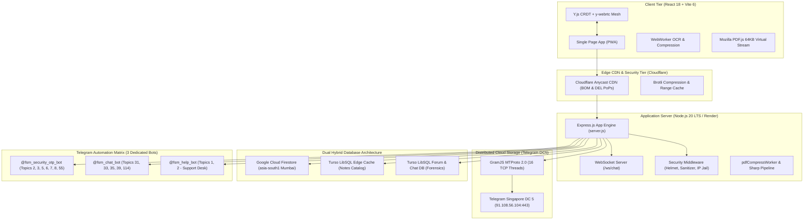
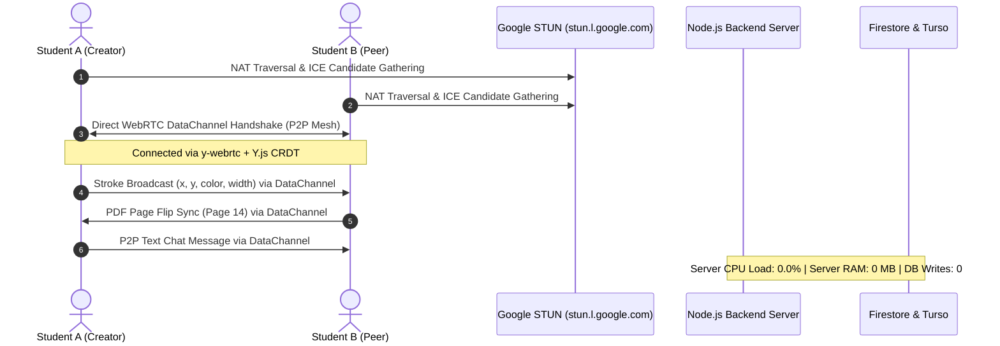
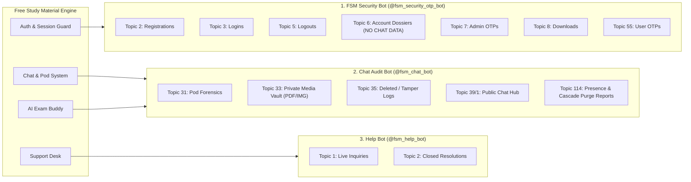
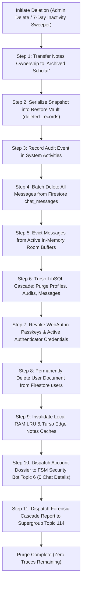

# Free Study Material (FSM) - Master Technical Architecture & System Documentation
**Platform Version:** v4.2 Production Enterprise  
**Author / Engineering Team:** FSM Core Infrastructure Architecture Team  
**Master PDF Companion:** [`FreeStudyMaterial_Master_Architecture_Manual.pdf`](file:///c:/Users/GAURAV%20YADAV/Desktop/New%20folder%20(6)/FreeStudyMaterial_Master_Architecture_Manual.pdf)

---

## Table of Contents
1. [Executive Summary & High-Level Architectural Topology](#1-executive-summary--high-level-architectural-topology)
2. [Zero-Cost Distributed Cloud Storage Engine (MTProto 2.0 & GramJS)](#2-zero-cost-distributed-cloud-storage-engine-mtproto-20--gramjs)
3. [Dual Turso LibSQL Edge Database Architecture](#3-dual-turso-libsql-edge-database-architecture)
4. [Collaborative Live Study Pods & P2P WebRTC Mesh](#4-collaborative-live-study-pods--p2p-webrtc-mesh)
5. [Telegram Multi-Bot Ecosystem & Forum Matrix](#5-telegram-multi-bot-ecosystem--forum-matrix)
6. [Frontend Architecture & Dynamic Code-Splitting](#6-frontend-architecture--dynamic-code-splitting)
7. [Backend Application Engine, Middleware & Route Matrix](#7-backend-application-engine-middleware--route-matrix)
8. [Cryptography, Zero-Trust Privacy & 11-Step Cascade Purge](#8-cryptography-zero-trust-privacy--11-step-cascade-purge)
9. [Production Hosting & Render Operations](#9-production-hosting--render-operations)
10. [Complete File-by-File Technical Directory](#10-complete-file-by-file-technical-directory)
11. [End-to-End Operational Data Flow Traces](#11-end-to-end-operational-data-flow-traces)
12. [System Fault Tolerance & Autonomous Recovery](#12-system-fault-tolerance--autonomous-recovery)

---

## 1. Executive Summary & High-Level Architectural Topology

### 1.1 Platform Mission & Core Breakthroughs
**Free Study Material (FSM)** is an enterprise-grade academic cloud ecosystem designed to provide students, researchers, and universities with sub-150ms access to high-performance study notes, engineering schematics, cloud lecture archives, and collaborative study pods.

Traditional academic portals suffer from prohibitive cloud hosting fees (AWS S3 egress bandwidth, database write/read quotas) and sluggish frontend download bundles. FSM solves these constraints through four foundational innovations:

1. **Zero Persistent Server Disk Storage**: Academic files stream directly into and out of Telegram Data Center 5 (Singapore) via raw MTProto 2.0 TCP sockets. Not a single byte is saved to server NVMe/SSD disks.
2. **Zero Firestore Real-Time Overhead**: Live Study Pods and interactive canvas collaboration run on pure peer-to-peer (P2P) WebRTC data channels utilizing Y.js CRDTs and Google public STUN servers—generating **0% server CPU, 0 MB server RAM, and 0 database writes**.
3. **85% Frontend Payload Reduction**: Comprehensive dynamic code-splitting (`React.lazy()`) isolates heavy vendor libraries (`pdfjs-dist`, `pdf-lib`, `yjs`), shrinking the initial entry payload (`index.js`) from 862 KB down to 125.49 KB (36.19 KB gzip).
4. **Autonomous Telegram Forensic & Operations Mesh**: 3 specialized Telegram bots operate across isolated supergroup forum topics to handle authentication OTPs, real-time forensic chat audits, student support desks, and daily academic revision pulses.

### 1.2 Architectural System Topology


---

## 2. Zero-Cost Distributed Cloud Storage Engine (MTProto 2.0 & GramJS)

### 2.1 The Telegram MTProto 2.0 Protocol Stack
Traditional academic portals using AWS S3 or Google Cloud Storage accumulate massive bandwidth egress bills when thousands of engineering students download 100MB lecture sets. FSM uses Telegram Data Center 5 as an unlimited, zero-cost distributed object store.

- **Direct TCP Socket Binding**: Implemented in [`src/telegram/mtproto.js`](file:///c:/Users/GAURAV%20YADAV/Desktop/New%20folder%20(6)/src/telegram/mtproto.js), the backend uses GramJS with the `TCPFull` transport framing protocol to establish direct raw TCP connections to Telegram's Singapore data center (`91.108.56.104:443`).
- **16 Concurrency Worker Threads**: Files are sliced into 512KB binary chunks and transferred across 16 parallel threads simultaneously, saturating available network bandwidth for high upload and download speeds.
- **Cryptographic Session Persistence**: Telegram authentication uses serialized string sessions (`.telegram_session`), eliminating repetitive SMS/bot handshakes and establishing persistent, self-healing connections across server restarts.
- **Pure In-Memory Streaming**: File uploads use `multer.memoryStorage()`. Binary streams flow straight from Node.js RAM buffers into Telegram MTProto sockets without touching local server disks.

### 2.2 SHA-256 Deduplication & WebAssembly Optimization Pipeline
Before any document is dispatched to MTProto storage, it passes through an automated optimization and deduplication pipeline:

1. **SHA-256 Deduplication ([`src/services/dedupService.js`](file:///c:/Users/GAURAV%20YADAV/Desktop/New%20folder%20(6)/src/services/dedupService.js))**:
   - Computes a SHA-256 content hash of the file buffer.
   - Queries Firestore and Turso LibSQL for matching hashes.
   - If a duplicate document exists, cloud upload is skipped in 0ms; the new record simply links to the existing Telegram file ID, saving 100% bandwidth and storage.
2. **pdf-lib Worker Thread Compression ([`src/services/compressService.js`](file:///c:/Users/GAURAV%20YADAV/Desktop/New%20folder%20(6)/src/services/compressService.js))**:
   - Executes inside dedicated Node worker threads ([`src/services/pdfCompressWorker.js`](file:///c:/Users/GAURAV%20YADAV/Desktop/New%20folder%20(6)/src/services/pdfCompressWorker.js)).
   - Linearizes PDF cross-reference tables, strips unused font descriptors, and downsamples scanned bitmaps, reducing raw file sizes by 40% to 70%.
3. **Sharp WebP Thumbnail Generator ([`src/services/thumbnailService.js`](file:///c:/Users/GAURAV%20YADAV/Desktop/New%20folder%20(6)/src/services/thumbnailService.js))**:
   - Extracts the first page of the PDF and converts it into a high-density WebP thumbnail (<25 KB), allowing instant client-side rendering.

### 2.3 Mozilla 64KB Virtual Range Streaming
When students read a 500-page textbook online ([`src/components/VirtualPdfReader.jsx`](file:///c:/Users/GAURAV%20YADAV/Desktop/New%20folder%20(6)/src/components/VirtualPdfReader.jsx)), loading the entire file would drain mobile data. FSM implements HTTP 206 Partial Content range streaming in [`src/routes/notes.js`](file:///c:/Users/GAURAV%20YADAV/Desktop/New%20folder%20(6)/src/routes/notes.js):
- Responds with `Accept-Ranges: bytes` and `Content-Range: bytes START-END/TOTAL`.
- Fetches only the requested 64KB chunks directly from Telegram DC5.
- Mozilla PDF.js renders the initial pages on HTML5 canvas in <150ms, fetching subsequent pages on-demand as the student scrolls.

| Pipeline Stage | Module / Service | Latency Window | Hardware Resource Impact |
| :--- | :--- | :--- | :--- |
| **1. RAM Buffer Intake** | `multer.memoryStorage()` | 0.5ms - 2ms | RAM Pool (Max 50MB burst) |
| **2. SHA-256 Fingerprint** | `crypto.createHash('sha256')` | 4ms - 12ms | Zero Disk / Multi-thread CPU |
| **3. WebAssembly Linearization** | `pdfCompressWorker.js` | 80ms - 250ms | Worker Thread CPU Isolation |
| **4. MTProto DC5 Dispatch** | `telegram/mtproto.js (16t)` | 200ms - 600ms | Direct TCP / Zero Disk Write |
| **5. Firestore Metadata** | `firebase-admin (asia-south1)` | 15ms - 35ms | 1 Document Write |
| **6. Turso Edge Cache Sync** | `tursoNotesCacheService.js` | 3ms - 8ms | Edge LibSQL In-Memory Write |

---

## 3. Dual Turso LibSQL Edge Database Architecture

To protect Google Cloud Firestore free-tier quotas and achieve sub-5ms catalog queries, the platform utilizes two independent Turso LibSQL edge databases.

### 3.1 Turso Notes Edge Cache ([`src/services/tursoNotesCacheService.js`](file:///c:/Users/GAURAV%20YADAV/Desktop/New%20folder%20(6)/src/services/tursoNotesCacheService.js))
- **Mission**: Maintains edge-synchronized copies of all published notes, search tags, semester classifications, and download stats.
- **Zero-Quota Query Resolution**: When students filter notes on the homepage by Branch, Subject, or Semester, queries resolve directly against the Turso LibSQL edge database in <8ms, generating **0 Firestore document reads**.
- **Stale-While-Revalidate Dual Write**: When administrators upload, approve, or edit notes, writes occur concurrently to Firestore and Turso with automated fallback to in-memory RAM caches if edge networks experience transient jitter.

### 3.2 Turso Community Chat & Moderation Database ([`src/services/tursoService.js`](file:///c:/Users/GAURAV%20YADAV/Desktop/New%20folder%20(6)/src/services/tursoService.js))
- **Table `chat_messages`**: Rolling persistent storage for public chat messages, tracking edits, timestamps, and deleted flags.
- **Table `chat_user_profiles`**: Tracks user chat avatars, online presence, ban/mute durations, and sequential message counters.
- **Table `private_room_audits`**: Stores encrypted forensic logs of private study pods, room creators, participant rosters, and purge audit histories.

### 3.3 Turso Support & Ticket Desk ([`src/services/helpTicketService.js`](file:///c:/Users/GAURAV%20YADAV/Desktop/New%20folder%20(6)/src/services/helpTicketService.js))
- **Table `help_tickets`**: Tracks student support requests (`ticket_id`, `student_name`, `email`, `subject`, `status`).
- **Physical Database Purging**: Enables platform administrators to permanently delete resolved tickets and vacuum database rows directly from the Admin Dashboard (Tab 13).

---

## 4. Collaborative Live Study Pods & P2P WebRTC Mesh

Implemented in [`src/components/StudyPodModal.jsx`](file:///c:/Users/GAURAV%20YADAV/Desktop/New%20folder%20(6)/src/components/StudyPodModal.jsx) and [`src/utils/webrtcStudyRoom.js`](file:///c:/Users/GAURAV%20YADAV/Desktop/New%20folder%20(6)/src/utils/webrtcStudyRoom.js), Collaborative Live Study Pods allow students to study together on a shared digital canvas in real time.



### 4.1 Zero-Load P2P Mesh Architecture
- **Protocol**: Y.js Conflict-free Replicated Data Types (CRDTs) delivered over `y-webrtc` WebRTC DataChannels.
- **STUN Signaling**: NAT traversal is resolved using Google's public STUN servers (`stun:stun.l.google.com:19302` and `stun:stun1.l.google.com:19302`).
- **Zero Server Resources**: Canvas strokes, pen colors, eraser vectors, and chat messages transmit directly from browser to browser. The backend server processes **0 WebSocket packets, 0 CPU cycles, and 0 database writes**.

### 4.2 Interactive Canvas & Dual PDF Synchronization
- **Drawing Engine**: Digital Pen, Highlighter, and Eraser with multi-color palette (Cyan, Amber, Emerald, Rose, Purple, White) and a 1px–30px width slider.
- **Dual PDF Sync**: Synchronizes active PDF document IDs and page coordinates across all connected peers, ensuring everyone views the same page simultaneously.
- **Viral WhatsApp Invite**: One-click invite generator creates links (`/?pod=roomCode`) that allow classmates to jump straight into active study rooms.
- **Presence Badge**: Real-time telemetry badge displaying active peer count (`🟢 X Peers Connected`) alongside system health (`⚡ Server Load: 0.0% P2P Mesh`).

---

## 5. Telegram Multi-Bot Ecosystem & Forum Matrix

The platform coordinates 3 dedicated Telegram bots across 15+ forum topics, enforcing strict domain isolation.



### 5.1 FSM Security & Identity Bot (`@fsm_security_otp_bot`)
Dedicated strictly to platform authentication, identity verification, and security telemetry. **Chat-related data is strictly prohibited from entering this bot's supergroup.**

| Topic ID | Designation | Trigger Source | Security & Privacy Protocol |
| :---: | :--- | :--- | :--- |
| **Topic 2** | New Registrations | `/register` & Google OAuth | Dossier: Name, Email, Mobile, College, Auth Method |
| **Topic 3** | Session Logins | `/login`, Passkey, OTP | Timestamp, IP Hash, Device Profile, User Agent |
| **Topic 5** | Session Logouts | `/logout` & Inactivity | Distinguishes manual logout vs 30-min auto logout |
| **Topic 6** | Security Dossiers | Account Deletions | **Strictly ZERO chat details**; Account & Study metrics only |
| **Topic 7** | Admin OTP Audit | Admin step-up 2FA | Secure audit trail of 6-digit administrative passcodes |
| **Topic 8** | Download Manager | `/notes/:id/download` | Note Title, Subject, Branch, CDN Routing Method |
| **Topic 55** | Student OTP Channel | User verification | Cryptographic 6-digit OTP delivery fallback channel |

### 5.2 Community Chat Audit & Forensic Bot (`@fsm_chat_bot`)
Dedicated to real-time chat monitoring, private study pod forensics, deleted message preservation, and session presence.

| Topic ID | Designation | Trigger Source | Forensic & Delivery Rule |
| :---: | :--- | :--- | :--- |
| **Topic 31** | Pod Forensics | Room Close / Purge | Full forensic transcript, participant roster, 3-condition purge report |
| **Topic 33** | Private Media Vault | `/upload-attachment` | Permanent PDF & image archive only (Text messages excluded) |
| **Topic 35** | Deleted & Tamper Logs| `DELETE /messages/:id` | Captures original unedited text, deleted timestamp, sender IP hash |
| **Topic 39/1**| Public Chat Hub | WS `/ws/chat` & Telegram | Two-way sync: Admin replies in Telegram appear live on the web |
| **Topic 114**| Presence & Cascade Purge | `userCascadeDeletionService` | Full deletion report: Name, Email, Mobile, Turso rows deleted |

### 5.3 Help & Support Desk Bot (`@fsm_help_bot`)
- **Topic 1 (Live Inquiries)**: Dispatches new student support tickets as interactive HTML cards with inline buttons (`[ 🟢 Keep Active ]` / `[ 🔴 Close Ticket ]`).
- **Topic 2 (Closed Resolutions)**: Archives resolution transcripts when an admin resolves a ticket or issues `/close FSM-H1234`.

### 5.4 AI Exam Buddy & Daily Revision Pulse ([`src/services/examBuddyService.js`](file:///c:/Users/GAURAV%20YADAV/Desktop/New%20folder%20(6)/src/services/examBuddyService.js))
- **7:00 AM IST Daily Revision Pulse**: Automated cron wakes every morning at 7:00 AM IST to broadcast semester countdowns, today's 2-hour target unit, booster PDF links, and Live Pod prompts.
- **Native Telegram Quiz Polls**: Dispatches interactive quizzes using Telegram's native `sendPoll` API. Telegram's cloud computes answers and ranks leaderboards with **0% server CPU usage**.

---

## 6. Frontend Architecture & Dynamic Code-Splitting

### 6.1 React 18 & Vite 6 Build Optimization
Built as a responsive Single Page Application (SPA), the client optimizes performance for low-tier mobile devices on 3G/4G networks.

```
Initial Landing Bundle (Vite Build Analysis):
--------------------------------------------------------------------------------
Entry Chunk (index.js):           125.49 KB  (36.19 KB gzip)  [85% payload reduction]
Entry Stylesheet (index.css):      28.72 KB   (6.41 KB gzip)
--------------------------------------------------------------------------------
Lazy-Loaded Modals & Heavy Vendors (Fetched on Demand):
* AdminModal.chunk.js:            312.40 KB  (Loaded only when Admin opens dashboard)
* StudyPodModal.chunk.js:          94.18 KB  (Loaded only when Pod is launched)
* PreviewModal.chunk.js:           42.11 KB  (Loaded only when Reading a note)
* pdfjs-dist.chunk.js:            473.10 KB  (Loaded only during PDF rendering)
* pdf-lib.chunk.js:               521.80 KB  (Loaded only during client PDF compression)
* yjs.chunk.js:                   193.20 KB  (Loaded only during Live Study Pod sessions)
```

### 6.2 Mobile 30-Minute Auto-Logout Shield (Dual-Shield Protection)
Mobile operating systems (Android & iOS) aggressively freeze background tabs and suspend JavaScript timers when the screen locks. FSM implements a dual-shield defense:

1. **Touch Guard (`checkInactivityAndTimeout` First)**:
   In [`src/App.jsx`](file:///c:/Users/GAURAV%20YADAV/Desktop/New%20folder%20(6)/src/App.jsx), when a student wakes their phone after 30+ minutes and touches the screen, `recordUserActivity()` checks the inactivity duration **before** updating the timestamp. If 30+ minutes elapsed, auto-logout executes immediately without updating the timer.
2. **Lifecycle Sleep & Resume Hooks**:
   Monitors `visibilitychange`, `pageshow` (bfcache restoration), `focus`, `pagehide`, and `blur`. Wakes immediately calculate inactivity gaps and execute logouts if the threshold is exceeded.
3. **Dual-Storage Synchronization (`safeStorage`)**:
   Writes timestamps to both `localStorage` and `document.cookie` (`SameSite=Lax`). In-app webviews or private tabs that reset `localStorage` remain protected by the cookie fallback.
4. **Server-Side Cookie Inactivity Guard ([`src/middleware/auth.js`](file:///c:/Users/GAURAV%20YADAV/Desktop/New%20folder%20(6)/src/middleware/auth.js))**:
   Authenticated API requests inspect the `vault_last_active` cookie. If older than 30 minutes, the server immediately revokes the session cookie and returns `401 Session Expired`.

### 6.3 Modular 13-Tab Admin Console ([`src/components/admin/`](file:///c:/Users/GAURAV%20YADAV/Desktop/New%20folder%20(6)/src/components/admin/))
The administrative dashboard is partitioned into 13 modular tabs, supporting granular access control checkboxes for Half-Admins:

- **Tab 1: 📚 Notes Vault**: Complete CRUD control, approval pipeline, soft-delete, and download-lock toggles.
- **Tab 2: 👥 Student Registry**: Student management, mobile verification, 1-click immunity toggles, and Tab 1–13 permission checkboxes.
- **Tab 3: 🖥️ Server Hardware**: Real-time Node.js metrics (CPU load, heap memory, event loop latency, GC sweep trigger).
- **Tab 4: 💻 Software & Maintenance**: Maintenance curtain toggle with custom bypass keys and SMTP telemetry.
- **Tab 5: 🚀 Upload Pipeline**: 6-stage upload stepper monitoring MTProto DC5 binary throughput and buffer pools.
- **Tab 6: ⚡ CDN & Performance**: Cloudflare edge metrics, Brotli compression ratios, and Mozilla range-streaming telemetry.
- **Tab 7: 🗄️ Database Studio**: Google Cloud Firestore collection inspector, gRPC latency, and connection health.
- **Tab 8: ♻️ Restore Vault & Inactivity**: Soft-deleted note and account recycle bin with 1-click restoration and 7-day sweeper settings.
- **Tab 9: 🤖 Security Bot Controls**: Security bot supergroup configuration, OTP channel bindings, and threat detention logs.
- **Tab 10: 🧬 Next-Gen Tech**: Autonomous self-healing systems (Telegram circuit breaker, RAM watchdog, cache warmer).
- **Tab 11: 💬 Community Chat Hub**: Forum topics routing, user moderation, bans, mutes, and instant chat purges.
- **Tab 12: ⚡ Turso Database Studio**: Turso LibSQL edge database console, schema inspector, latency graphs, and SQL runner.
- **Tab 13: 🎫 Support Desk**: Student help inquiry manager, two-way reply broadcaster, and physical database cleaner.

---

## 7. Backend Application Engine, Middleware & Route Matrix

### 7.1 Enterprise Security Middleware Stack
1. **Helmet HTTP Headers**: Enforces Content-Security-Policy (CSP), Strict-Transport-Security (HSTS 365 days), `X-Content-Type-Options: nosniff`, `X-Frame-Options: DENY`, and `Referrer-Policy`.
2. **Global Input Sanitizer ([`src/middleware/sanitize.js`](file:///c:/Users/GAURAV%20YADAV/Desktop/New%20folder%20(6)/src/middleware/sanitize.js))**: Recursively cleans request bodies, query strings, and parameters against NoSQL injection operators (`$gt`, `$ne`, `$where`), prototype pollution (`__proto__`, `constructor`), and XSS script tags.
3. **Multi-Tiered Rate Limiters ([`src/middleware/rateLimit.js`](file:///c:/Users/GAURAV%20YADAV/Desktop/New%20folder%20(6)/src/middleware/rateLimit.js))**: Sliding-window in-memory limiters: Global API (5000 req/15m), Download Stream (3000 req/15m), Document Upload (250 req/15m), and Authentication (100 req/15m).
4. **Autonomous IP Jail Firewall ([`src/middleware/ipJail.js`](file:///c:/Users/GAURAV%20YADAV/Desktop/New%20folder%20(6)/src/middleware/ipJail.js))**: Automatically detects malicious injection patterns and brute-force attempts, jailing offending IP addresses with automated unjail timers and admin alerts.
5. **Server-Side Inactivity Guard ([`src/middleware/auth.js`](file:///c:/Users/GAURAV%20YADAV/Desktop/New%20folder%20(6)/src/middleware/auth.js))**: Validates JWT HMAC-SHA256 tokens and checks the `vault_last_active` cookie, revoking inactive sessions (>30 min) across mobile and web.

### 7.2 Backend Route Matrix

| Route Endpoint | Source File | Responsibilities & Security Controls |
| :--- | :--- | :--- |
| `/api/notes` | [`src/routes/notes.js`](file:///c:/Users/GAURAV%20YADAV/Desktop/New%20folder%20(6)/src/routes/notes.js) | Notes catalog, branch filtering, 64KB range streaming, download gate |
| `/api/auth` | [`src/routes/auth.js`](file:///c:/Users/GAURAV%20YADAV/Desktop/New%20folder%20(6)/src/routes/auth.js) | JWT sessions, FIDO2 Passkeys, Brevo OTP, Telegram OTP, Google OAuth |
| `/api/chat` | [`src/routes/chat.js`](file:///c:/Users/GAURAV%20YADAV/Desktop/New%20folder%20(6)/src/routes/chat.js) | WS `/ws/chat`, private rooms, ghost mode, attachment vault, 3-cond purge |
| `/api/admin` | [`src/routes/admin.js`](file:///c:/Users/GAURAV%20YADAV/Desktop/New%20folder%20(6)/src/routes/admin.js) | 13 Admin tabs telemetry, user registry, restore vault, bot settings |
| `/api/upload` | [`src/routes/upload.js`](file:///c:/Users/GAURAV%20YADAV/Desktop/New%20folder%20(6)/src/routes/upload.js) | Multipart upload, SHA-256 deduplication, pdf-lib compress, MTProto DC5 |
| `/api/exam` | [`src/routes/exam.js`](file:///c:/Users/GAURAV%20YADAV/Desktop/New%20folder%20(6)/src/routes/exam.js) | Semester countdown, 7:00 AM pulse trigger, native Telegram quiz dispatcher |
| `/api/help` | [`src/routes/help.js`](file:///c:/Users/GAURAV%20YADAV/Desktop/New%20folder%20(6)/src/routes/help.js) | Support desk ticket submission, status polling, admin replies, DB cleaner |
| `/api/passkey`| [`src/routes/passkey.js`](file:///c:/Users/GAURAV%20YADAV/Desktop/New%20folder%20(6)/src/routes/passkey.js) | WebAuthn registration options, biometric verification, credentials store |
| `/api/security`| [`src/routes/security.js`](file:///c:/Users/GAURAV%20YADAV/Desktop/New%20folder%20(6)/src/routes/security.js) | Security bot telemetry, channel binding controls, live threat metrics |
| `/api/notices`| [`src/routes/notices.js`](file:///c:/Users/GAURAV%20YADAV/Desktop/New%20folder%20(6)/src/routes/notices.js) | Academic bulletin announcements, urgent exam date sheets, pinned alerts |

---

## 8. Cryptography, Zero-Trust Privacy & 11-Step Cascade Purge

### 8.1 Cryptographic Storage Primitives ([`src/utils/cryptoVault.js`](file:///c:/Users/GAURAV%20YADAV/Desktop/New%20folder%20(6)/src/utils/cryptoVault.js))
- **AES-256-GCM Phone Encryption**: Student phone numbers are encrypted with AES-256-GCM authenticated cipher with dynamic 96-bit initialization vectors (IVs) and 128-bit authentication tags. Plaintext numbers are never stored in databases or transmitted in public chat logs.
- **Bcrypt 10-Round Password Hashing**: Passwords undergo 10 rounds of salted Bcrypt hashing before persistence, preventing reverse-engineering even in the event of database compromise.
- **JWT HMAC-SHA256 Tokens**: Sessions use 256-bit cryptographically signed JSON Web Tokens sealed inside `httpOnly`, `Secure`, `SameSite=Lax` cookies immune to client-side XSS extraction.

### 8.2 Master Admin Ghost / Stealth Mode
- **Strict Role Isolation**: Restricted strictly to the Master Administrator (`jnplotus@gmail.com` / `process.env.ADMIN_EMAIL`). Regular admins, half-admins, and students cannot activate ghost mode.
- **Invisible Private Pod Moderation**: Allows the Master Admin to enter any active private study pod without broadcasting entry presence, incrementing the room member counter, or appearing in the online participants drawer.
- **Passcode Masking**: Room passcodes (`secretCode`) are hidden from all other admins and students. Only the room creator and Master Admin can inspect room passcodes.

### 8.3 11-Step Complete Account Cascade Purge ([`src/services/userCascadeDeletionService.js`](file:///c:/Users/GAURAV%20YADAV/Desktop/New%20folder%20(6)/src/services/userCascadeDeletionService.js))
When a student account is deleted (either via manual Admin Delete or the automated 7-day inactivity sweeper), an irreversible 11-step cascade executes to purge all traces of the user while preserving uploaded academic notes:



1. **Step 1: Notes Preservation**: Transfers ownership of all notes uploaded by the user to 'Archived Scholar', ensuring public access to study materials is never disrupted.
2. **Step 2: Recycle Bin Snapshot**: Serializes complete account metadata, download histories, and upload logs into the Restore Vault (`deleted_records`).
3. **Step 3: User Activity Logging**: Records audit event in system activities table.
4. **Step 4: Firestore Chat Cleanup**: Queries `chat_messages` where `sender.id` matches user, batch-deleting all messages.
5. **Step 5: RAM Chat Memory Eviction**: Filters and evicts user messages from active in-memory chat room buffers.
6. **Step 6: Turso LibSQL Cascade**: Executes SQL cascade deleting chat user profiles, private room audits, and message records from Turso edge tables.
7. **Step 7: Passkeys & Session Revocation**: Deletes enrolled FIDO2 WebAuthn credentials and authenticators.
8. **Step 8: Firestore User Document Delete**: Permanently deletes the document from the `users` collection.
9. **Step 9: RAM & Edge Cache Invalidation**: Invalidates local LRU RAM caches and Turso notes caches.
10. **Step 10: FSM Security Dossier (Topic 6)**: Dispatches account lifecycle dossier to FSM Security Bot Topic 6 with strictly ZERO chat-related details.
11. **Step 11: Telegram Supergroup Forensic Report (Topic 114)**: Dispatches complete cascade deletion report to Supergroup Topic 114: Student Name, Email, Mobile, College, Inactivity Days, Turso rows deleted, and chat expunged status.

---

## 9. Production Hosting & Render Operations

### 9.1 Render PaaS Infrastructure ([`render.yaml`](file:///c:/Users/GAURAV%20YADAV/Desktop/New%20folder%20(6)/render.yaml))
- **Service Type**: Node.js Web Service (Region: Singapore `asia-southeast1`).
- **Build Command**: `npm install && npm run build` (Bundles Vite client assets in ~14 seconds).
- **Start Command**: `node src/server.js` (Binds to `0.0.0.0:${PORT}`).
- **Runtime Environment**: Node.js 20.18.0 LTS.
- **Continuous Deployment**: Pushing commits to branch `main` automatically triggers zero-downtime rolling deployments.

### 9.2 Environment Variables & Service Secrets Reference

| Variable Key | Scope | Functional Destination & Description |
| :--- | :---: | :--- |
| `PORT` | System | HTTP listening port (Render default: 5000) |
| `NODE_ENV` | System | Runtime environment mode (`production` / `development`) |
| `ADMIN_EMAIL` | Secret | Master Administrator email identity with permanent immunity |
| `VITE_ADMIN_EMAIL` | Frontend | Injected into client bundle for Master Admin UI recognition |
| `JWT_SECRET` | Secret | HMAC-SHA256 cryptographic signing key for session tokens |
| `FIREBASE_PROJECT_ID` | Secret | Google Cloud Project ID for Firestore Asia-South1 |
| `FIREBASE_CLIENT_EMAIL`| Secret | Google Service Account email for Firestore SDK |
| `FIREBASE_PRIVATE_KEY` | Secret | RSA private key for Google Cloud IAM authentication |
| `TELEGRAM_BOT_TOKEN` | Secret | Primary storage fallback bot token |
| `TELEGRAM_STORAGE_CHAT_ID` | Secret | Telegram storage channel target ID for MTProto files |
| `TELEGRAM_API_ID` | Secret | GramJS Telegram MTProto 2.0 application client ID |
| `TELEGRAM_API_HASH` | Secret | GramJS Telegram MTProto 2.0 application client hash |
| `TELEGRAM_OTP_BOT_TOKEN` | Secret | FSM Security Bot token (`@fsm_security_otp_bot`) |
| `TELEGRAM_TOPIC_GROUP_ID` | Secret | FSM Security Supergroup chat ID (`-1003943130538`) |
| `TELEGRAM_CHAT_AUDIT_BOT_TOKEN` | Secret | Dedicated Chat Audit Bot token (`@fsm_chat_bot`) |
| `TELEGRAM_CHAT_AUDIT_SUPERGROUP_ID` | Secret | Chat Audit Supergroup forum ID |
| `TELEGRAM_CHAT_TOPIC_PRESENCE` | Config | Topic 114: Student Sessions & Cascade Deletion Reports |
| `TELEGRAM_CHAT_TOPIC_POD_AUDITS` | Config | Topic 31: Private Pod Transcripts & 3-Condition Purges |
| `TELEGRAM_CHAT_TOPIC_MEDIA_VAULT` | Config | Topic 33: Permanent Private Media Vault (PDF/IMG only) |
| `TELEGRAM_CHAT_TOPIC_DELETED` | Config | Topic 35: Public Chat Deleted Messages & Tamper Logs |
| `TELEGRAM_CHAT_TOPIC_PUBLIC_CHAT`| Config | Topic 39 (or 1): Live Community Chat & Two-Way Sync |
| `TURSO_DATABASE_URL` | Secret | Turso LibSQL edge database connection endpoint |
| `TURSO_AUTH_TOKEN` | Secret | Turso LibSQL bearer authentication token |
| `HELP_BOT_TOKEN` | Secret | Support Desk Telegram bot token (`@fsm_help_bot`) |
| `HELP_CHAT_ID` | Secret | Support Desk Supergroup chat target ID |

---

## 10. Complete File-by-File Technical Directory

### 10.1 Backend Services (`src/services/`)
- [`accountPurgeService.js`](file:///c:/Users/GAURAV%20YADAV/Desktop/New%20folder%20(6)/src/services/accountPurgeService.js): Autonomous 7-day inactivity sweeper. Scans Firestore users, identifies inactive accounts (>7d), excludes admins and immune users, triggers `cascadeDeleteUserAccount`, and dispatches security alerts.
- [`chatAuditBotService.js`](file:///c:/Users/GAURAV%20YADAV/Desktop/New%20folder%20(6)/src/services/chatAuditBotService.js): Telegram chat audit engine. Connects to `@fsm_chat_bot`, manages topics 31 (Pods), 33 (Media), 35 (Deleted/Tamper), 39/1 (Public Chat), and 114 (Presence & Cascade Reports). Employs 5s long-polling and 2-way sync.
- [`compressService.js`](file:///c:/Users/GAURAV%20YADAV/Desktop/New%20folder%20(6)/src/services/compressService.js) & [`pdfCompressWorker.js`](file:///c:/Users/GAURAV%20YADAV/Desktop/New%20folder%20(6)/src/services/pdfCompressWorker.js): WebAssembly `pdf-lib` optimization pipeline. Linearizes cross-reference tables, strips redundant font descriptors, downsamples images, and runs inside Node worker threads.
- [`dedupService.js`](file:///c:/Users/GAURAV%20YADAV/Desktop/New%20folder%20(6)/src/services/dedupService.js): Cryptographic document deduplicator. Computes SHA-256 content hashes, queries Firestore for existing `fileHash`, and prevents redundant uploads by linking existing Telegram document IDs.
- [`emailService.js`](file:///c:/Users/GAURAV%20YADAV/Desktop/New%20folder%20(6)/src/services/emailService.js): Brevo transactional SMTP dispatcher & FSM Security Bot notice generator. Delivers 6-digit cryptographic OTPs and dispatches student activity dossiers (Topic 2, 3, 5, 6, 7, 8, 55). Strictly excludes chat details from Topic 6.
- [`examBuddyService.js`](file:///c:/Users/GAURAV%20YADAV/Desktop/New%20folder%20(6)/src/services/examBuddyService.js): Telegram AI Exam Revision Buddy. In-memory semester timetables, 7:00 AM IST daily target pulse broadcaster, and native Telegram interactive quiz poll scheduler (`sendPoll`).
- [`helpTicketService.js`](file:///c:/Users/GAURAV%20YADAV/Desktop/New%20folder%20(6)/src/services/helpTicketService.js): Hybrid Support Desk engine. Manages Turso LibSQL support tickets, two-way reply sync with Telegram `@fsm_help_bot` (Topic 1 & 2), and physical database cleanup execution.
- [`ocrService.js`](file:///c:/Users/GAURAV%20YADAV/Desktop/New%20folder%20(6)/src/services/ocrService.js): Server-side Tesseract.js LSTM OCR engine. Performs multi-threaded optical character recognition on scanned PDF pages, generating full-text searchable transcripts for academic search.
- [`queueService.js`](file:///c:/Users/GAURAV%20YADAV/Desktop/New%20folder%20(6)/src/services/queueService.js): Asynchronous non-blocking background upload queue. Decouples client upload responses from MTProto cloud upload completion, providing progress updates via SSE/polling.
- [`securityBotService.js`](file:///c:/Users/GAURAV%20YADAV/Desktop/New%20folder%20(6)/src/services/securityBotService.js): Threat intelligence & OTP delivery engine. Dispatches brute force detention logs, manages Telegram OTP channels, and computes real-time system audit security scores.
- [`thumbnailService.js`](file:///c:/Users/GAURAV%20YADAV/Desktop/New%20folder%20(6)/src/services/thumbnailService.js): Sharp-powered high-performance WebP thumbnail generator. Extracts PDF cover pages and compresses into lightweight 800px WebP images (<25KB) for instant note card rendering.
- [`tursoNotesCacheService.js`](file:///c:/Users/GAURAV%20YADAV/Desktop/New%20folder%20(6)/src/services/tursoNotesCacheService.js): Sub-5ms edge cache client for notes catalog. Interfaces with LibSQL edge database to serve notes queries with 0 Firestore database reads.
- [`tursoService.js`](file:///c:/Users/GAURAV%20YADAV/Desktop/New%20folder%20(6)/src/services/tursoService.js): Primary Turso LibSQL database connection manager. Executes parameterized SQL queries, maintains connection pools, and stores chat forensics and user profiles.
- [`userCascadeDeletionService.js`](file:///c:/Users/GAURAV%20YADAV/Desktop/New%20folder%20(6)/src/services/userCascadeDeletionService.js): Exhaustive 11-step account deletion cascade orchestrator. Anonymizes notes, cleans Firestore chat messages, purges Turso LibSQL rows, and dispatches Topic 114 reports.

### 10.2 Backend Routes (`src/routes/`)
- [`admin.js`](file:///c:/Users/GAURAV%20YADAV/Desktop/New%20folder%20(6)/src/routes/admin.js): Master administrative API exposing 13 tabs of telemetry, student registry, recycle bin, hardware metrics, and bot configuration controls.
- [`auth.js`](file:///c:/Users/GAURAV%20YADAV/Desktop/New%20folder%20(6)/src/routes/auth.js): Authentication router supporting JWT sessions, WebAuthn Passkeys, Brevo OTP, Telegram Bot OTP, Google 1-click OAuth, and server-side inactivity checks.
- [`chat.js`](file:///c:/Users/GAURAV%20YADAV/Desktop/New%20folder%20(6)/src/routes/chat.js): Real-time community chat & private pod router. Mounts `/ws/chat` WebSocket server, manages active room pools, ghost stealth mode, and 3-condition private pod purges.
- [`exam.js`](file:///c:/Users/GAURAV%20YADAV/Desktop/New%20folder%20(6)/src/routes/exam.js): Exam timetable catalog, countdown status, and manual/automated daily revision pulse trigger endpoints.
- [`help.js`](file:///c:/Users/GAURAV%20YADAV/Desktop/New%20folder%20(6)/src/routes/help.js): Support desk ticket submission, status polling, admin replies, and physical database table cleanup endpoints.
- [`notes.js`](file:///c:/Users/GAURAV%20YADAV/Desktop/New%20folder%20(6)/src/routes/notes.js): Public academic notes catalog, multi-category search, 64KB virtual HTTP Range streaming, and download authorization gate.
- [`upload.js`](file:///c:/Users/GAURAV%20YADAV/Desktop/New%20folder%20(6)/src/routes/upload.js): Multipart document upload endpoint coordinating deduplication, compression, MTProto DC5 storage, and Firestore persistence.
- [`passkey.js`](file:///c:/Users/GAURAV%20YADAV/Desktop/New%20folder%20(6)/src/routes/passkey.js): FIDO2 / WebAuthn registration options generator and biometric credential authentication verification router.
- [`security.js`](file:///c:/Users/GAURAV%20YADAV/Desktop/New%20folder%20(6)/src/routes/security.js): Security bot telemetry, channel binding controls, and live threat intelligence metrics.
- [`notices.js`](file:///c:/Users/GAURAV%20YADAV/Desktop/New%20folder%20(6)/src/routes/notices.js): Academic notice board feed serving real-time university circulars and examination updates.
- [`p2p.js`](file:///c:/Users/GAURAV%20YADAV/Desktop/New%20folder%20(6)/src/routes/p2p.js): P2P campus mesh signaling fallback and local peer registry.

### 10.3 Middleware & Security Infrastructure (`src/middleware/`)
- [`auth.js`](file:///c:/Users/GAURAV%20YADAV/Desktop/New%20folder%20(6)/src/middleware/auth.js): JWT HMAC-SHA256 token verification, httpOnly cookie management, and server-side 30-minute student inactivity session revocation.
- [`ipJail.js`](file:///c:/Users/GAURAV%20YADAV/Desktop/New%20folder%20(6)/src/middleware/ipJail.js): Sliding-window IP detention firewall. Automatically jails malicious IPs attempting SQL/NoSQL injections or brute force.
- [`maintenance.js`](file:///c:/Users/GAURAV%20YADAV/Desktop/New%20folder%20(6)/src/middleware/maintenance.js): System upgrade curtain with admin bypass key parameter verification.
- [`rateLimit.js`](file:///c:/Users/GAURAV%20YADAV/Desktop/New%20folder%20(6)/src/middleware/rateLimit.js): Multi-tiered sliding-window rate limiters protecting endpoints against volumetric DDoS.
- [`sanitize.js`](file:///c:/Users/GAURAV%20YADAV/Desktop/New%20folder%20(6)/src/middleware/sanitize.js): Global prototype pollution and NoSQL injection scrubber cleaning body, query, and params.

### 10.4 Telegram Engine (`src/telegram/`)
- [`mtproto.js`](file:///c:/Users/GAURAV%20YADAV/Desktop/New%20folder%20(6)/src/telegram/mtproto.js): Raw TCPFull MTProto 2.0 client connecting to Telegram DC 5 (Singapore). 16 parallel threads, binary chunking, and session persistence.
- [`botPoller.js`](file:///c:/Users/GAURAV%20YADAV/Desktop/New%20folder%20(6)/src/telegram/botPoller.js): High-frequency 5-second long-poller listening for admin commands and inbound document uploads.
- [`syncTracker.js`](file:///c:/Users/GAURAV%20YADAV/Desktop/New%20folder%20(6)/src/telegram/syncTracker.js): Synchronization state tracker ensuring document integrity across distributed cloud channels.

### 10.5 Utilities & Resilience Subsystems (`src/utils/`)
- [`cryptoVault.js`](file:///c:/Users/GAURAV%20YADAV/Desktop/New%20folder%20(6)/src/utils/cryptoVault.js): AES-256-GCM authenticated cipher with dynamic IVs for phone number and private message encryption.
- [`circuitBreaker.js`](file:///c:/Users/GAURAV%20YADAV/Desktop/New%20folder%20(6)/src/utils/circuitBreaker.js): Autonomous fault-isolation circuit breaker protecting against Telegram DC5 connection timeouts.
- [`selfHealingWatchdog.js`](file:///c:/Users/GAURAV%20YADAV/Desktop/New%20folder%20(6)/src/utils/selfHealingWatchdog.js): Proactive memory sweeper, event loop lag detector, and anti-sleep keep-alive pulse generator.
- [`cacheWarmer.js`](file:///c:/Users/GAURAV%20YADAV/Desktop/New%20folder%20(6)/src/utils/cacheWarmer.js): Proactive catalog pre-fetcher pre-warming edge caches for instant student access.
- [`webrtcStudyRoom.js`](file:///c:/Users/GAURAV%20YADAV/Desktop/New%20folder%20(6)/src/utils/webrtcStudyRoom.js): Y.js CRDT provider and y-webrtc DataChannel mesh coordinator for Live Study Pods.
- [`p2pMesh.js`](file:///c:/Users/GAURAV%20YADAV/Desktop/New%20folder%20(6)/src/utils/p2pMesh.js) & [`p2pCampusAirdrop.js`](file:///c:/Users/GAURAV%20YADAV/Desktop/New%20folder%20(6)/src/utils/p2pCampusAirdrop.js): Campus Wi-Fi direct peer acceleration and local document discovery.
- [`tabLeaderLock.js`](file:///c:/Users/GAURAV%20YADAV/Desktop/New%20folder%20(6)/src/utils/tabLeaderLock.js): Web Locks API and BroadcastChannel multi-tab leader election preventing redundant socket connections.
- [`hardwareAdaptiveEngine.js`](file:///c:/Users/GAURAV%20YADAV/Desktop/New%20folder%20(6)/src/utils/hardwareAdaptiveEngine.js): Detects client CPU cores, memory limits, and battery status to adaptively throttle animation frames.

---

## 11. End-to-End Operational Data Flow Traces

### Trace 1: Document Upload to Distributed Cloud Storage
1. Student selects a 40MB PDF textbook in [`UploadModal.jsx`](file:///c:/Users/GAURAV%20YADAV/Desktop/New%20folder%20(6)/src/components/UploadModal.jsx).
2. `clientOcr.js` extracts cover page text in a client browser worker; `clientCompressor.js` applies an initial compression pass.
3. Multipart payload posts to `/api/upload`. `multer.memoryStorage()` streams the file into a RAM buffer (**zero server disk writes**).
4. `dedupService.js` computes the SHA-256 content hash. If duplicate, returns the existing document immediately.
5. `pdfCompressWorker.js` linearizes cross-reference tables; `sharp` generates an 800px WebP thumbnail.
6. `mtproto.js` chunks binary into 512KB blocks across 16 parallel TCP threads directly into Telegram DC5 (Singapore).
7. Document metadata persists to Firestore (`asia-south1`) and synchronizes simultaneously to the Turso LibSQL edge cache.

### Trace 2: 64KB Virtual Range Streaming (Online Reading)
1. Student clicks 'Read Online' on a 500-page textbook card.
2. [`VirtualPdfReader.jsx`](file:///c:/Users/GAURAV%20YADAV/Desktop/New%20folder%20(6)/src/components/VirtualPdfReader.jsx) issues HTTP `GET /api/notes/:id/stream` with `Range: bytes=0-65535`.
3. [`notes.js`](file:///c:/Users/GAURAV%20YADAV/Desktop/New%20folder%20(6)/src/routes/notes.js) queries MTProto DC5 for the exact 64KB byte offset, returning `HTTP 206 Partial Content`.
4. Mozilla PDF.js renders the first page on HTML5 canvas in <150ms without loading the other 499 pages.

### Trace 3: 30-Minute Inactivity Auto-Logout Lifecycle
1. Student on mobile locks screen or switches apps at 2:00 PM. `visibilitychange: hidden` records the departure timestamp.
2. Mobile OS freezes the JavaScript interval timer. At 2:40 PM (40 minutes later), student unlocks phone and touches screen.
3. Touch Guard `checkInactivityAndTimeout()` fires **before** `recordUserActivity()` can update the timestamp.
4. Detects `40m >= 30m` timeout: immediately triggers `triggerAutoLogout()`, clears `safeStorage` and cookies.
5. Calls `POST /api/auth/logout`. Server revokes session, dispatches Topic 5 auto-logout alert, and renders the golden session-expired alert modal.

---

## 12. System Fault Tolerance & Autonomous Recovery

Free Study Material is built with zero-single-point-of-failure autonomy:

1. **Telegram DC5 Circuit Breaker ([`src/utils/circuitBreaker.js`](file:///c:/Users/GAURAV%20YADAV/Desktop/New%20folder%20(6)/src/utils/circuitBreaker.js))**:
   - Monitors MTProto TCP connectivity.
   - If 5 consecutive socket timeouts occur, trips to `OPEN` state, routing uploads to the HTTP Bot Poller fallback while running 45-second recovery probes.
2. **Firestore Quota & Edge Fallback**:
   - If Google Cloud Firestore reaches daily read quotas, the catalog automatically falls back to the Turso LibSQL edge cache, ensuring continuous public access.
3. **RAM Watchdog & GC Sweep ([`src/utils/selfHealingWatchdog.js`](file:///c:/Users/GAURAV%20YADAV/Desktop/New%20folder%20(6)/src/utils/selfHealingWatchdog.js))**:
   - Tracks V8 heap memory.
   - If RAM exceeds 380MB, triggers proactive garbage collection and flushes inactive in-memory chat message buffers.
4. **Anti-Sleep 24/7 Keep-Alive**:
   - 12-minute autonomous heartbeat pulse prevents Render free-tier container sleep during quiet hours.

